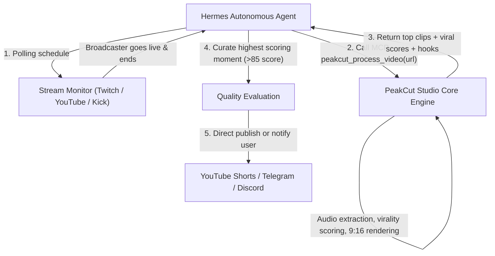
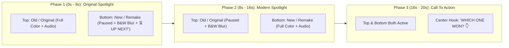

# PeakCut Studio - Potential Upgrades & Roadmap

> **Document Status**: Living Roadmap  
> **Target Project**: `peakcut-studio/`  
> **Last Updated**: November 2026

---

## Executive Overview
PeakCut Studio has successfully achieved:
- 100% free, self-hosted clipping with zero subscription or token paywalls.
- Fast audio-first range ingestion (~15 MB audio stream + surgical 30s video slice downloads).
- Triple AI peak scoring: YouTube engagement heatmaps, multi-dimensional dialogue virality (humor, jokes, tension, hooks), and EBU R128 loudness reaction spikes.
- Burned vertical 9:16 video formatting with word-timed karaoke subtitles (`Bounce`, `Hype`, `Clean`) and pinned top hook banners.
- Automatic 10-minute audio chunking preventing Groq Whisper HTTP 413 "Request Entity Too Large" errors on long streams.
- Full local storage cleanup mechanisms.

The following upgrades outline the path from a manual web clipping tool into a fully automated, autonomous content creation and distribution powerhouse.

---

## ✅ STAGE 1 COMPLETE — Modular Template UI Picker
> Built: Template picker bar with 3 cards (Viral Clipper, Versus Studio, Gaming Split). All templates selectable and form swaps dynamically. TypeScript 0 errors.

## ✅ STAGE 2 COMPLETE — Versus Studio (Template 2) + Gaming Split (Template 3)
> Built: `versusRenderer.ts`, `gamingSplitRenderer.ts`, `/api/versus`, `/api/gaming-split`. Both templates have live functional forms with real download + render + result display. TypeScript 0 errors.

## ✅ STAGE 3 COMPLETE — Clip Edit Mode & Timeline Studio
> Built: `EditModePanel.tsx` side panel with 9:16 interactive playback scrubber, layout switcher (Blurred Fill vs Center Crop), caption font size slider (50%–200%), vertical subtitle placement (Top/Middle/Bottom), and video trim controls. Backed by `/api/rerender` pipeline. Accessible via pencil icon on clip cards. TypeScript 0 errors.

## ✅ STAGE 4 COMPLETE — 1-Click Direct YouTube Shorts Publishing
> Built: `src/lib/youtube.ts`, `/api/auth/youtube/url`, `/api/auth/youtube/callback`, `/api/auth/youtube/status`, and `/api/youtube/publish`. Added 1-click modal `YouTubePublishModal.tsx` on every ClipCard with prefilled AI metadata, visibility controls (Public, Unlisted, Draft), and scheduled release date support. Connected with `CLIENT_ID` and `CLIENT_SECRET` in `.env`. TypeScript 0 errors.

## ✅ STAGE 5 COMPLETE — Deep Harvest & "Get More Clips" Engine
> Built: Non-overlapping secondary scene discovery engine in `findPeakMoments` & `generateMoreClips` (`/api/clips/more`). Added 1-click `Get More Clips (+3 Next Moments)` button on both active jobs and saved library videos to discover secondary/conversational viral moments (70–88 score tier) without re-downloading or re-transcribing. Added initial output clip count selector (3, 5, or 8 clips). TypeScript 0 errors.

---

## Core Architecture Upgrade: Modular Studio Templates Suite

### Concept
Transform PeakCut Studio from a single-format clipper into a **Multi-Format Content Studio**.
Creators pick a **Template Preset** at the top of the dashboard (`Viral Clipper`, `Versus Comparison`, `Gaming Split`, `Podcast Two-Box`). The input fields, processing pipeline, and rendering filters dynamically reconfigure based on the chosen format.

```
+---------------------------------------------------------------------------------------------------+
|                                        STUDIO TEMPLATE SUITE                                      |
|                                                                                                   |
|  [ ⚡ Viral Clipper ]     [ ⚔️ Versus Comparison ]     [ 🎮 Gaming Split ]     [ 🎙️ Podcast Split ]  |
|      (Default)                                                                                    |
+---------------------------------------------------------------------------------------------------+
```

### The Template Catalog

#### Template 1: ⚡ Viral Stream Clipper (Active)
* **What it does**: Analyzes 1-to-3 hour livestreams/VODs for humor, jokes, tension, and audience heatmap spikes. Reframes to 9:16 with burned animated karaoke subtitles and hook banners.
* **Inputs**: 1 YouTube/Twitch/Kick link or local video file.
* **Rendering**: Center-crop or Blurred Background Fill (1080x1920) + `.ass` Karaoke burn.

#### Template 2: ⚔️ Versus Studio (Alternating Comparison Engine)
* **What it does**: Creates top-vs-bottom comparison clips (*"Old vs New"*, *"Then vs Now"*, *"Original vs Remake"*). While one version plays in full color/audio, the waiting version is **paused, desaturated to Black & White, and blurred** with a countdown badge, then swaps!
* **Inputs**: Two video URLs/files (or two timestamp ranges) + Custom Labels (e.g. `2004` vs `2024`).
* **Rendering**: Stacked 1080x960 dual filtergraph with automated B&W desaturation, boxblur, audio cross-fading, and center `VS` badge.

#### Template 3: 🎮 Gaming Split-Screen (Cam + Gameplay)
* **What it does**: The #1 format for TikTok and YouTube Shorts gaming creators. Automatically crops the streamer's facecam to the top 35% of the 9:16 vertical canvas and places the centered gameplay action on the bottom 65%.
* **Inputs**: 1 Stream / Gameplay recording + Facecam position preset (Top-Left, Top-Right, Bottom-Right, or Drag-to-Select).
* **Rendering**: Dual-crop stack: `[0:v]crop=cam[top]; [0:v]crop=game[bot]; [top][bot]vstack` with subtitles placed on the divider sweet spot.

#### Template 4: 🎙️ Podcast / Talk Show (Two-Box Stack)
* **What it does**: Converts horizontal 16:9 two-person interviews and podcasts into a vertical stack: Host on the top half, Guest on the bottom half.
* **Inputs**: 1 Video URL / Upload + Framing mode (Left/Right split into Top/Bottom stack).
* **Rendering**: Dual side-by-side extraction re-stacked into vertical 9:16.

#### Template 5: 🎬 Cinematic Supercut / Montage
* **What it does**: Cuts together rapid-fire 2–3 second highlights set to trending background beats, ideal for gaming clutches, sports reels, or movie hype trailers.
* **Inputs**: 1 Video URL + Target tempo / duration (e.g., 15-second hyper-edit).

---

## Upgrade 1: Hermes Autonomous Agent & MCP Integration

### Concept
Connect PeakCut Studio to **Hermes** (autonomous agent framework) via **MCP (Model Context Protocol)** so Hermes can act as a 24/7 personal video editor and social media manager without human intervention.



### Proposed MCP Tools to Expose:
1. `peakcut_process_video`: Starts an ingestion and clipping job given a URL or file path, caption style, and frame layout.
2. `peakcut_get_clips`: Retrieves generated clips, viral scores, hooks, and local file paths for a job.
3. `peakcut_check_streamer_live`: Probes whether a Twitch, Kick, or YouTube channel is currently live.
4. `peakcut_clear_storage`: Programmatically cleans cached storage when disk thresholds are reached.

---

## Upgrade 2: 1-Click Direct YouTube Shorts Publishing

### Concept
Eliminate the manual step of downloading the MP4 and uploading to YouTube Studio by integrating the YouTube Data API v3 with OAuth2.

### Features
* **Settings OAuth Connection**: Enter Google Cloud Client ID and Secret in Settings to link your YouTube channel once.
* **1-Click Card Action**: A "Publish to YouTube Shorts" button directly on each rendered clip card.
* **Pre-Filled Metadata**: Automatically transfers the AI-crafted Title, Description, and Hashtags (including `#shorts`).
* **Privacy Toggle**:
  * `Private / Draft`: Uploads as a draft so you can review in YouTube Studio.
  * `Unlisted`: Shareable via link before going public.
  * `Public`: Immediately published to your subscribers.
* **Scheduled Publishing**: Set release date and time (e.g. "Tomorrow at 6:00 PM") to schedule a week of Shorts from one long stream.

---

## Upgrade 3: Streamer Split-Screen Layouts (Gaming & Podcast)

### Concept
Move beyond *Blurred Background Fill* and *Center Crop* into vertical split-screen framing—the dominant visual format on TikTok, Reels, and YouTube Shorts.

### Layout Presets
1. **Gaming Layout (Webcam Top + Gameplay Bottom)**:
   * Upper 35% of the frame: Cropped and zoomed on the streamer's face/webcam.
   * Lower 65% of the frame: Cropped and centered on the gameplay action.
2. **Podcast / Interview Layout (Host Top + Guest Bottom)**:
   * Upper half: Host camera.
   * Lower half: Guest camera.
3. **Interactive Crop Coordinate Selector**:
   * A visual preview box where creators can drag a bounding box around their webcam overlay once per channel.

---

## Upgrade 4: Interactive In-Browser Clip Trimmer & Subtitle Editor

### Concept
Allow creators to quickly fine-tune AI-selected clips before final export.

### Features
* **Waveform Range Slider**: A dual-handle slider beneath the 9:16 preview player to shift clip start or end time by ±2–5 seconds (e.g., catching the tail end of a reaction).
* **Click-to-Edit Words**: Click directly on any word in the subtitle preview to fix streamer-specific slang, gamer tags, or misheard words.
* **Hook Headline Override**: Click and edit the top banner text (`\an8`) to test different viral hook variants.

---

## Upgrade 5: Telegram & Discord Webhook Notifications

### Concept
Receive mobile notifications as soon as long livestreams are processed.

### Features
* Enter a Discord Webhook URL or Telegram Bot Token in Settings.
* When PeakCut finishes rendering clips:
  * Sends a mobile push notification.
  * Attaches compressed video previews.
  * Includes the ready-to-copy title, description, and hashtags for quick mobile sharing.

---

## Upgrade 6: Sound Effects & Meme Audio Insertion

### Concept
Elevate clip engagement by emphasizing punchlines with subtle sound effects.

### Features
* Auto-insert subtle comedic audio cues (e.g., *vine boom*, *record scratch*, *dramatic hit*, *subtle laughter*) at the exact timestamp of an identified punchline or climax.
* User toggle in Settings: `Enable Meme Audio Accents [On / Off]`.

---

## Upgrade 7: Versus Studio (Alternating Comparison Engine: Then vs Now)

### Concept
Create split-screen comparison videos (*"Old vs New"*, *"Original vs Remake"*, *"Manga vs Anime"*, *"IRL vs In-Game"*) where two versions are compared vertically (9:16 stacked) with an **alternating spotlight mechanic**:
While one version plays in full color and audio, the waiting version is **frozen, blurred, and desaturated to Black & White**. When it switches, the focus shifts to reveal the other version!



### Visual & Technical Architecture
1. **Dual Ingestion**: User inputs two URLs or video files (e.g. `Clip A: GTA SA 2004` and `Clip B: GTA V 2013`), or two timestamp ranges from the same video.
2. **Stacked 9:16 Stacking**:
   - Both inputs scaled & cropped to `1080x960` (occupying exact top and bottom halves).
3. **Turn-Based Filtergraph**:
   - Clip A active: Clip B is passed through FFmpeg `hue=s=0,boxblur=12:5` with a muted audio track.
   - Clip B active: Clip A switches to `hue=s=0,boxblur=12:5`.
4. **Interactive Badging**:
   - Custom labels: e.g. `2004` vs `2024`, `ORIGINAL` vs `REMAKE`, `MANGA` vs `ANIME`.
   - Center `VS` diamond badge between the clips.
   - Pinned ending call-to-action: *"Which one is better? Comment below!"* to drive viral algorithm debate metrics.

### Applicable Genres Beyond Gaming:
- **Gaming Evolution**: Physics comparisons, graphical overhauls, sound design comparisons.
- **Anime & Manga**: Manga panels vs animated adaptations.
- **Cinematography & VFX**: Practical stunts vs modern CGI.
- **Music & Production**: Original vintage audio sample vs modern billboard hit song.
- **Tech Evolution**: Vintage gadget/OS vs modern day flagship.
- **IRL vs Fiction**: Real world drone footage vs in-game map recreation.

---

## Prioritization Matrix

| Priority | Feature / Template | Effort | User Impact |
| :---: | :--- | :---: | :---: |
| **P1** | **Modular Studio Template Suite (UI & Selector)** | Low | 🔥 High (Unlocks multi-format creation menu) |
| **P1** | **Template 2: Versus Studio (Old vs New Comparison)** | Medium | 🔥 High (Proven mega-viral format) |
| **P1** | **Direct YouTube Shorts Publishing** | Medium | 🔥 High (Cuts workflow time in half) |
| **P1** | **Hermes Autonomous Agent Integration (MCP)** | Medium | 🔥 High (Enables 24/7 background clipping) |
| **P2** | **Template 3: Gaming Split-Screen (Webcam + Game)** | Medium | 🔥 High (Standard TikTok/Shorts gaming format) |
| **P2** | **Template 4: Podcast Two-Box (Host + Guest Stack)** | Low | Medium (Interview & podcast reformatting) |
| **P2** | **Interactive In-Browser Clip Trimmer** | Medium | Medium (Creator control & polish) |
| **P3** | **Telegram / Discord Bot Notifications** | Low | Medium (Mobile convenience) |
| **P3** | **Sound Effects / Meme Accents** | Low | Low (Fun creative polish) |
